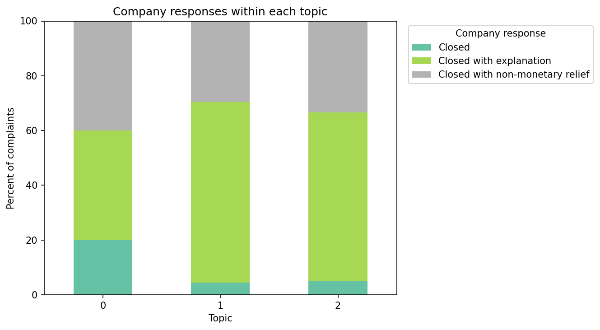

# Complaint_Text_Analysis
A Regex text analysis of a complaints database

# Getting Started
Download the python and excel sheet and upload onto Google Drive in the folder structure provided within the file.
If you wish to change the file name or folder structure, make sure to change appropriately within the code 

# Consumer Complaint Analysis

**Python · pandas · regex · TF-IDF · LDA · Matplotlib**

An exploratory analysis of 200 consumer complaint narratives: what topic groups appear, and how do recorded company responses vary across them?

## Main findings

| Topic ID | Complaints | Closed | Closed with explanation | Closed with non-monetary relief |
| --- | ---: | ---: | ---: | ---: |
| 0 | 10 | 20.0% | 40.0% | 40.0% |
| 1 | 91 | 4.4% | 65.9% | 29.7% |
| 2 | 99 | 5.1% | 61.6% | 33.3% |

- Closed with explanation was the most common response overall: 125 of 200 complaints (62.5%).
- Topics 1 and 2 had broadly similar response distributions.
- Topic 0 contained only 10 complaints, so one complaint changes its percentages by 10 points.
- Topic names remain provisional; numeric IDs are used throughout this summary.

## Missing dispute data
Only 74 of 200 complaints have a recorded consumer-dispute value; 126 are missing. Of the recorded values, 18 are True and 56 are False. Missing values are not counted as False.

The 33.0% and 38.4% figures for Topics 1 and 2 are **recording coverage**, not dispute rates. Among recorded values, the True proportions are 9/30 and 8/38 respectively. These subsets may not represent all complaints in their topic.

## Analysis workflow
1. Prepare and clean complaint narratives using regular expressions.
2. Explore word frequencies and TF-IDF features.
3. Fit exploratory LDA topic models; refine the vocabulary to reduce recurring company names and numeric artifacts.
4. Assign each complaint to its highest-weight topic for summary tables.
5. Compare response categories and report missing dispute values separately.

## Files
- [Main analysis notebook](Regex-project.ipynb)
- [Wrap-up notebook and conclusion](Kanak_Project_Wrap_Up.ipynb)
- [Exported charts and tables](kanak_project_results/)
- [Input workbook](CFPB_Consumer_Complaints_2024.xlsx)

## Run notes
The main notebook currently expects CSV files in a Google Drive folder. The repository supplies an XLSX workbook, so this workflow needs manual preparation:
1. Download the input workbook and export the relevant complaint sheet to `CFPB_Consumer_Complaints_2024.csv`, preserving the headers. Check the sheet before export.
2. Open `Regex-project.ipynb` in Colab. Update the Drive input path to the CSV location.
3. Follow its cleaning and model cells. When it writes `cleaned_complaints.csv`, ensure the later reload cell points to that saved file.
4. Use the refined three-topic model consistently when constructing `analysis_df`; do not mix the earlier six-topic results with it.
5. Export `analysis_df` as `complaints_with_topics.csv`, then upload it in the wrap-up notebook when prompted.

Dependencies include pandas, NumPy, Matplotlib, scikit-learn and SciPy, with Google Colab used for Drive/upload steps. This workflow has not yet been verified from a clean environment.

## Dataset and limitations
The repository contains a workbook named CFPB_Consumer_Complaints_2024.xlsx. The exact original download link, retrieval date and sampling/filtering procedure still need to be documented; the filename alone does not establish those details.

This analysis describes the 200 analyzed narratives, not all consumers or all CFPB complaints. The three-topic model is exploratory, topic groups overlap, and a dominant-topic assignment simplifies topic mixtures. Company-response categories do not establish consumer satisfaction or successful resolution. These are descriptive associations, not causal effects. The planned comparison of complaints with and without narratives is outside the completed analysis shown here.
